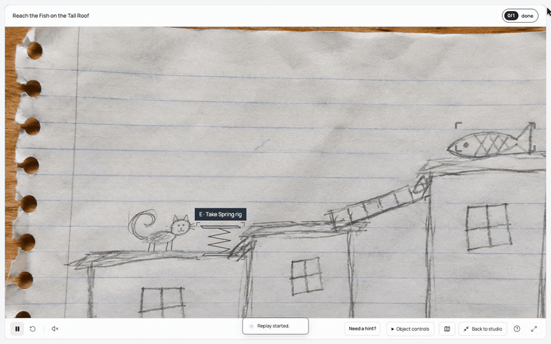
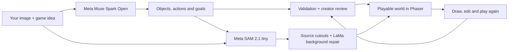

# Doodlume: the game starts with your picture

**Your imagination, now playable.**

*By Sreenath Menon*

There is a cat on a rooftop, a ladder between buildings and a fish waiting at the other end. It is the sort of picture that already suggests a little adventure. You can imagine the cat making the jump long before you think about collision boxes, controls or game rules.

Doodlume starts there. Bring a drawing or photograph, describe what you want to play, and turn it into a world you can enter. Then keep creating inside it.

[Try Doodlume](https://doodlume-production-9df2.up.railway.app/)

## The part I care about most

I wanted the creator's imagination to stay involved after the first game appears. You might play a scene and decide it needs a new tool. You might want a different goal, a new interaction between two objects, or another way to move through the picture.

In Doodlume, those ideas have somewhere to go. You can draw a new part, give it an ability, choose what it works with and try it in the same world. You can edit objects and finishing rules, undo a change, save the result and come back to it.

That is the creative loop I want the product to make inviting: picture something, make it playable, discover another possibility, then build on it.

## A spring makes the idea visible

The rooftop example gives this loop a simple, visible consequence.

First, the cat has its normal jump. In the studio, a new spring is drawn and given an ability: attach it to the cat to increase jump height. Back in play, the cat picks up the spring, fits it and jumps higher. The player can see the effect of the part they just created.

*This is a continuous excerpt from real product gameplay at normal speed. The rooftop source is an AI-generated rough drawing; the spring and its ability were authored in the studio.*

A spring is one way to use the system. The broader idea is giving pictured or newly drawn objects a role in what happens. The engine supports movement, abilities, resource transfers, prerequisites, discoveries and completion conditions. The editor gives the creator ways to work with those systems.

For someone making a game, that turns playing into part of the design process. Try an idea, see its effect and decide what to change next.

## Photographs bring another kind of possibility

A photograph already contains places, objects and relationships. Those details can become material for an interactive experience.

In the [patio example](https://doodlume-production-9df2.up.railway.app/#studio?example=patio-care), a real photograph contains a watering can and a succulent pot. Doodlume turns those pictured objects into a goal-driven interaction. Select the can, use it on the pot and watch the game's water quantity transfer as the goal completes.

This is an interaction built around the photograph. It changes game state; it does not simulate pouring liquid or growing a plant. The original image remains recognizable and inspectable throughout.

Doodlume also supports exploration through an image and clue-based discovery of its details. A drawing might invite an adventure. A photograph might invite a search, exploration or an object challenge. The source and the creator's idea help determine which supported form of play makes sense.

The [lunar rescue](https://doodlume-production-9df2.up.railway.app/#studio?example=rover) shows another side of the engine. Allocate crystals to power the beacon and rover, then fit the antenna to move the rover and complete the rescue. This is an authored example, included to show how several object actions can connect into a mission.

## How a picture becomes a game

There are two things the system needs to understand: what is visible in the image and what the creator wants to do with it.

**Meta Muse Spark Open**, served through **Fireworks AI**, handles that interpretation. The image and creator intent go into a request. The response describes objects, their relationships, proposed actions and goals in a structured form.

Doodlume checks the resulting plan before it reaches the player. Object geometry, interactions, artwork and completion requirements have to fit the application's world contract. The creator can inspect the interpretation and correct selections that need attention.

Moving original artwork introduces another problem. A cat drawn on a page is part of a single image. To let it move independently, the system needs a usable outline of that subject.

**Meta SAM 2.1 tiny** runs on the application server to produce supported object masks. The cutouts retain the source image's colors and marks, with an alpha mask separating the subject from its surroundings. This helps the moving character remain recognizably connected to the picture it came from.

When a subject moves away, its old position can leave a hole or a duplicate behind. **LaMa**, a separate non-Meta model, reconstructs exposed background where the pipeline calls for learned repair. Source-art checks and explicit fallback states remain important when an outline is unclear or a subject is obscured.

The playable result runs in **Phaser**. Doodlume's application code handles movement, interactions, resources and finishing conditions. **React and TypeScript** provide the studio and shared world contracts. The primary application is hosted on **Railway**; **Modal** was also used for a verified application deployment and is documented as backup hosting.

Fireworks supplies the active model API path. SAM and LaMa run within the hosted application environment. The repository also contains Baseten and direct Meta API adapters; their available integrations and recorded usage are described separately in the [README](README.md#models-api-providers-and-deployment-partners).

## The world should be worth returning to

A creator needs room to experiment. Changing an object should not mean losing the entire world. Trying an ability should be reversible. A saved game should reopen with the changes the creator made.

Doodlume keeps world identity through revisions and preserves progress tied to objects and achievements that remain in the revised world. It supports undo, browser-local saves and portable exports containing artwork, rules and progress.

These details matter because a game idea usually takes more than one attempt. You play something, notice what would make it more interesting and want to try again. Keeping that process understandable is part of making creation enjoyable.

For an indie creator, this offers a direct starting point: use your own visual material, test it through play and develop it through objects and rules. The source can be a rough drawing. The idea can begin small and grow through the changes you make.

## What I want to improve next

The next challenge is stronger automatic game design from unfamiliar pictures. Recognizing an object is one step. Finding an interesting role for it, connecting it to other objects and producing a satisfying objective is a deeper design problem.

The direction is richer relationships between source objects, more expressive creator-authored abilities and more varied missions with clear feedback. Some images still need correction, and inference can take time. Those are areas to improve as the creation system develops.

The working foundation is already there: image interpretation, original-art processing, editable rules, real play and a world you can save and continue. The next work should make the creative possibilities broader while keeping the creator in control.

I want Doodlume to make it easier to follow the thought that arrives while looking at a picture: this could be a game, and I know what I want to happen next.

**Doodlume. Your imagination, now playable.**

[Create a world](https://doodlume-production-9df2.up.railway.app/#studio) · [Read the technical overview](README.md) · [Inspect the evidence](docs/REVIEW-EVIDENCE.md)

---

The playable examples are saved worlds, so opening one does not trigger a new inference request. The patio source photograph is by [Shixart1985, CC BY 2.0](https://commons.wikimedia.org/wiki/File:Person_waters_succulents_on_a_table_in_an_outdoor_setting.jpg). The rooftop drawing and lunar illustration are AI-generated assets. Full source and example details are in the [showcase credits](public/art/showcase/README.md).
