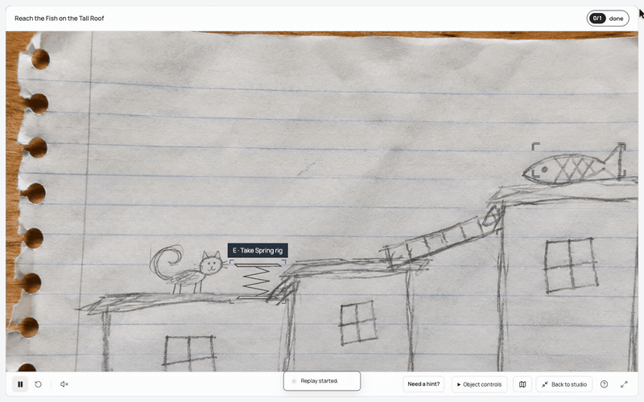
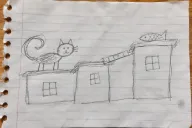
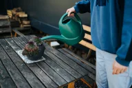
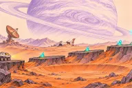
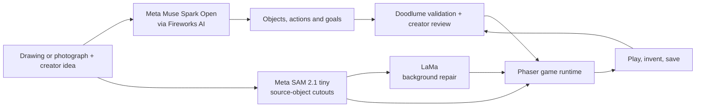

<div align="center">

# Doodlume

### Your imagination, now playable.

**Turn your drawings and photographs into playable worlds. Then invent what happens next.**

[Open Doodlume](https://doodlume-production-9df2.up.railway.app/) · [Create a world](https://doodlume-production-9df2.up.railway.app/#studio) · [Try the spring game](https://doodlume-production-9df2.up.railway.app/#studio?example=rooftop-springs)

</div>

A cat on a notebook page can become a character you control. A photograph can become a challenge built around the things in it. Draw a spring, give it an ability, and change how high your character can jump.

Doodlume brings image understanding, original artwork and game creation into one experience. Start with a picture and an idea. Review the world it creates, play inside it, then keep shaping its objects, abilities and goals. You can create through drawing, photographs and an editor without writing game code.

[](https://doodlume-production-9df2.up.railway.app/#studio?example=rooftop-springs)

*An uninterrupted excerpt from real product gameplay, converted to a looping GIF at normal speed. The rooftop source is an AI-generated rough drawing. The spring was drawn and given an ability in the studio.*

## Create a world. Keep inventing inside it.

1. **Bring a picture and an idea.** Upload a drawing, illustration or photograph, or draw directly in the studio. Describe the experience you want to create.
2. **Review what Doodlume understood.** Inspect the original, recognized objects and proposed gameplay. Correct the parts that need your input.
3. **Play.** Move, jump, explore, discover details or use objects, depending on the world and its rules.
4. **Invent the next possibility.** Draw a new part, give it an ability, move objects or change what completes the game. Preview an ability before applying it.
5. **Keep your creation.** Save and reopen the world, undo edits, or export a portable backup containing its artwork, rules and progress.

The spring is one example of this loop. The editor also supports object interactions, resource transfers, prerequisites, discoveries and finishing requirements. Those systems can be combined to create different challenges within the engine's supported mechanics.

## Three worlds to try

| [Rooftop springs](https://doodlume-production-9df2.up.railway.app/#studio?example=rooftop-springs) | [A little care](https://doodlume-production-9df2.up.railway.app/#studio?example=patio-care) | [Lunar rescue](https://doodlume-production-9df2.up.railway.app/#studio?example=rover) |
| :---: | :---: | :---: |
| [](https://doodlume-production-9df2.up.railway.app/#studio?example=rooftop-springs) | [](https://doodlume-production-9df2.up.railway.app/#studio?example=patio-care) | [](https://doodlume-production-9df2.up.railway.app/#studio?example=rover) |
| Fit a newly drawn spring to the cat and gain a higher jump. | Use the pictured can on the pot to complete a game-resource watering challenge. | Allocate crystals, power the beacon and rover, then fit the rescue antenna. |
| Meta-generated game with a creator-authored ability. | Meta-generated game from a real photograph. | Authored example using the same interaction engine. |

These are ready-to-play examples. To create something new, open the studio and supply your own image. The drawing and lunar illustration are AI-generated assets. The photograph is by [Shixart1985, CC BY 2.0](https://commons.wikimedia.org/wiki/File:Person_waters_succulents_on_a_table_in_an_outdoor_setting.jpg). Full [example provenance and credits](public/art/showcase/README.md) are included in the repository.

## Different pictures, different ways to play

| Play style | What the player does |
| --- | --- |
| **Adventure** | Move and jump, collect objects, activate linked interactions and reach a destination. Original subjects can become moving characters and props. |
| **Exploration** | Move freely through an image, discover its objects and trigger interactions positioned in the source. |
| **Discovery** | Follow clues and find pictured details in place, with optional hints, editable requirements and pointer or keyboard controls. |

The same world format supports these styles. Creation is driven by the image, creator intent and validated rules, rather than a lookup table assigning a fixed game to a sample filename.

## How the picture becomes playable



The models and the game engine have different jobs:

| Model | What it contributes |
| --- | --- |
| **Meta Muse Spark Open** | Interprets the image and creator intent, identifies objects and their relationships, and proposes structured gameplay. Served through **Fireworks AI** in the live build. |
| **Meta SAM 2.1 tiny** | Separates supported subjects from their original backgrounds so the source artwork can move independently. Runs on the application server. |
| **LaMa** | Repairs background exposed when source subjects move. This is a separate, non-Meta model running on the application server. |

**Meta connects the picture to the game.** Muse provides the semantic understanding needed to turn visible details into characters, destinations, clues and actions. SAM provides the object separation needed to move original artwork. Doodlume checks those outputs and turns them into rules a player can use and a creator can edit.

The model returns structured data, not executable game code. The application checks geometry, source artwork, interaction requirements and completion rules before accepting a world. Original-image inspection and creator correction remain part of the workflow.

The interface uses **React and TypeScript**, gameplay uses **Phaser**, and the Node.js application runs on **Railway**. Additional adapters support direct Meta Muse Wonder or Muse Spark, direct SAM 3.1, and Muse Spark Open through Baseten. Those are integration options; the live demonstration uses the three-model pipeline above.

## Run locally

Requires **Node.js 22.12 or newer** and credentials for a supported inference provider.

```sh
git clone https://github.com/sreenathmmenon/doodlume.git
cd doodlume
npm install
cp .env.example .env.local
```

Edit the ignored `.env.local` file. For the Fireworks path used in the live product, select:

```dotenv
MODEL_PROVIDER=fireworks
FIREWORKS_API_KEY=your_fireworks_key
FIREWORKS_MODEL=accounts/fireworks/models/muse-spark-open
```

Then start the studio:

```sh
npm run studio
```

Open **http://127.0.0.1:5173**. This builds and serves a stable local snapshot. Use `npm run dev` for development with Vite and the API server.

### Source-object cutouts and background repair

To install local Meta SAM 2.1, use Python 3.10 or newer. The setup script defaults to `python3.11`:

```sh
npm run setup:cutouts
```

Then add `CUTOUT_PROVIDER=local-sam2` to `.env.local`. The worker uses MPS on supported Apple Silicon installations and CPU otherwise. Model files live outside the repository. For the separate LaMa background-repair setup and model provenance, see [source background repair](docs/SOURCE-BACKGROUND-REPAIR.md).

Provider keys stay on the server. Never commit `.env.local`, provider credentials or model checkpoints. Deployment details are in [live deployment](docs/LIVE-DEPLOYMENT.md).

## Engineering and verification

The implementation keeps source imagery, introduced game elements and completion rules distinct. Edits retain world identity and progress associated with objects and achievements that remain in the revised world. Undo and portable backups preserve the information needed to return to earlier versions.

```sh
npm run check
npm test
npm run build
npm run check:secrets
```

Checks cover world and interaction contracts, source-art processing, provider recovery, editing, undo, saved worlds and renderer behavior. Real inference runs and browser playthroughs are documented separately in [live validation](docs/LIVE-VALIDATION.md) and [source-to-play verification](docs/QUALITY-REPAIR-VERIFICATION.md).

| Code | Responsibility |
| --- | --- |
| [`server/interpret.ts`](server/interpret.ts) | Image interpretation and game creation |
| [`server/provider.ts`](server/provider.ts) | Model-provider requests and explicit provider selection |
| [`server/segmentation.ts`](server/segmentation.ts) | Source-art extraction and mask handling |
| [`server/source-background.ts`](server/source-background.ts) | Background reconstruction |
| [`shared/world.ts`](shared/world.ts) | World definition and validation |
| [`src/game/`](src/game/) | Playable runtime and feedback |
| [`src/components/`](src/components/) | Homepage, studio and creator interface |

### Current scope

Doodlume creates editable 2D experiences within its movement, interaction and discovery systems. Unclear or obscured subjects can need creator correction, and generation time depends on the input and provider. Photo resource transfers change game quantities; they do not simulate physical liquid or plant growth. Saved worlds live in the browser's IndexedDB, with portable export and import for moving them between installations.

Built by [Sreenath Menon](https://github.com/sreenathmmenon) for the Meta Global AI Developer Hackathon.
